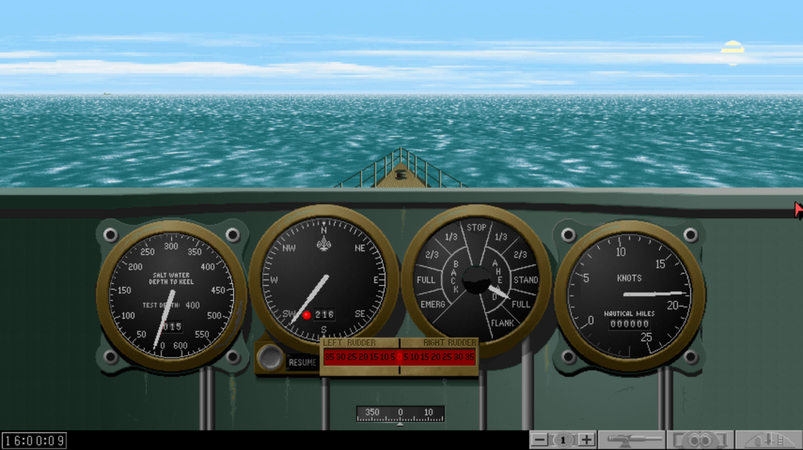
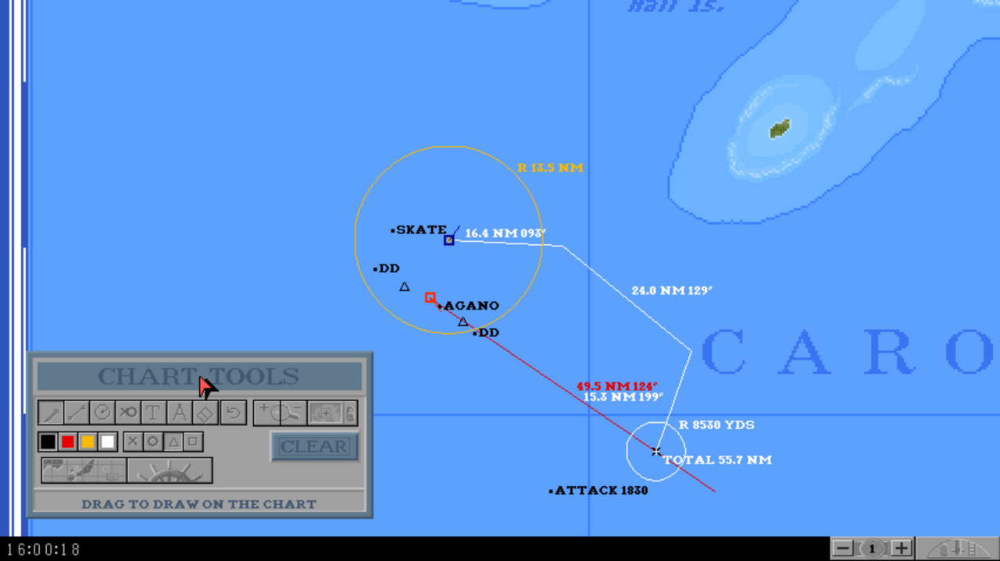
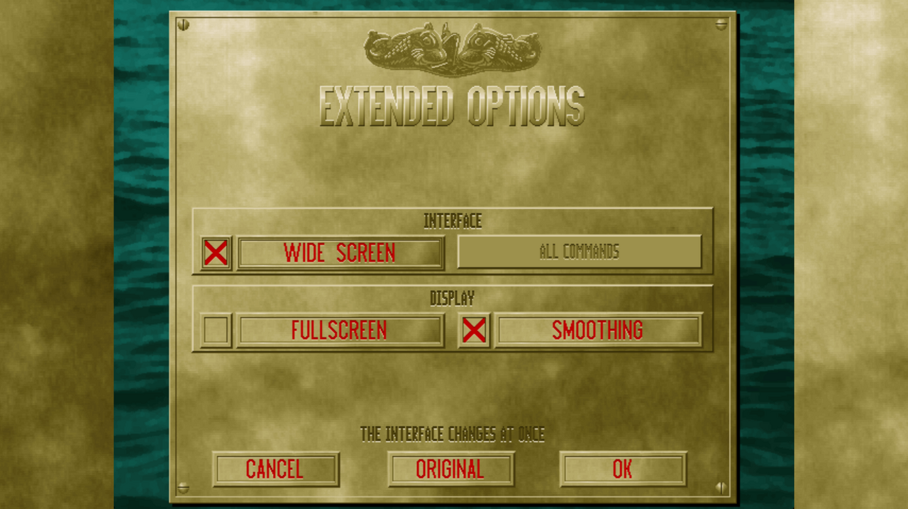

# Silent Heritage

Silent Heritage is an open-source reimplementation of *Silent Hunter*, the
World War II US submarine simulation published by MicroProse in 1995. It runs
on Windows, macOS, Linux and Android, and includes both the game itself and
the scenario editor that came with the Commander's Edition.

## Playing

1. **Get the original game.** Silent Heritage is only an engine: it plays
   your own copy of Silent Hunter and does not include any of its files. For
   now, it needs an *installed* version of the original game to read them
   from, and you will need the Commander's Edition if you want to use the
   scenario editor.

2. **Download** the package for your system from the
   [latest release](https://github.com/conning-tower/SilentHeritage/releases/latest):

   - **Windows** 10 or later (x64): unzip the `.zip` anywhere and start the
     program. It is not signed, so Windows SmartScreen will ask for
     confirmation the first time you run it: click "More info", then "Run
     anyway".
   - **macOS** 13.3 or later (Apple Silicon and Intel): open the `.dmg` and
     drag the app onto Applications. As it is not notarized by Apple, macOS
     will refuse to open it the first time. Click Done, then go to System
     Settings, Privacy & Security, and click "Open Anyway". If you use
     [Homebrew](https://brew.sh), you can avoid that warning entirely with
     `brew install conning-tower/tap/silent-heritage`, which builds the game
     on your Mac.
   - **Linux** (x86_64 or aarch64, with glibc 2.35 or later, as in Ubuntu
     22.04 and Debian 12): make the `.AppImage` executable and run it. The
     `.tar.gz` contains the same program, with a menu entry and an icon.
   - **Android** 7.0 or later (phones, tablets and Chromebooks): the `.apk`,
     which you will need to sideload.

3. **Start it.** The first time you launch the game, it will ask for the
   folder where Silent Hunter is installed (the one holding `SH.EXE` and
   `DATA`). On Android, you can either let it read that folder where it is or
   copy it into the app. Silent Heritage never writes into the original
   install: your saves, options and scenarios all go to a Silent Heritage
   folder in your home folder.

## Classic and Extended

Each release comes in two versions, which can be installed side by side.

- **Silent Heritage** is the classic version. It plays the original game as it
  was, with the same simulation, rules and screens, and even its bugs. The UI,
  however, is slightly improved to make it playable on modern systems and touch
  screens, and to avoid the crashes of the original.

- **Silent Heritage Extended** builds on the classic version with a number of
  improvements and new features: support for wide screens, a crew log, map
  annotations, new equipment, bug fixes, etc. See below for a complete list.

## Improvements

### Classic version

In addition to using modern input methods (with your actual keyboard layout),
audio, etc., the following improvements are made in the Classic version:

- Per-user save files, outside of the original DOS folder.
- Smooth scaling of the original 640x480 UI to any window size. Full screen mode
  can be toggled with Alt+Enter.
- Android-specific improvements:
  - Touch controls, with a tap for a left click and the back gesture for a right
    click.
  - Natural scrolling on the map UI through finger drag.
  - Small floating "ORDERS" button to quickly enter usual keyboard shortcuts.
  - Automatic save and restore of the current game state when exiting the app
    while playing.
- Bug fixes:
  - Many data-loss and data-corruption bugs are fixed, especially in the
    scenario editor.
  - Fixed the game hanging when an ASW patrol was generated with too many ships.
  - Fixed scrolling through the interview videos.

### Extended version

In addition to the fixes from the Classic version, the Extended version adds
many more quality-of-life improvements and new content to the game.

#### Interface

- **Crew log:** click the message strip at the bottom of the screen, or press
  L, to read the mission's last 100 crew messages with their game times.
- **Chart tools:** the chart's TOOLS button opens a toolbox to draw on the
  map (pencil, lines labelled with range and bearing, range circles, marks
  with the time they were put, notes, a ruler, an eraser and undo).
- **Chart scrolling:** drag the chart with the mouse or a finger to scroll it.
- **Chart zooming:** zoom the chart smoothly with the mouse wheel or a
  two-finger pinch.
- **Command bar on the chart:** the chart shows the command bar like the
  other stations.
- **Nautical chart scale:** the chart's scale bar reads in nautical miles,
  and in yards close in (the Classic version uses statute miles there).
- **Boat choice:** the encounters' sub choice screen remembers your last choice.
- **Extended options:** a new options menu to toggle wide screen support and
  other optional improvements.
- **Turning the views:** drag the bridge, periscope, TBT or deck gun view to
  turn it, and flick it to keep it turning for a moment.
- **Precise dials:** drag a dial sideways to set its value.
- **Command bar:** the ORDERS button can sit in the bottom bar, float as in
  the Classic version, or be hidden.
- **Live ORDERS panel:** on touch screens, the ORDERS panel shows the
  current depth order and the state of each tube.
- **Mission menu:** Esc opens a menu to reach the game options and save the
  mission or the career.
- **Wide screens:** the game fills screens wider than 4:3, up to 21:9. The
  chart shows more of the map and the bridge a wider view.

#### Rules

- **Sonar reports:** the sound man only reports a ship he has already
  reported again after losing it for 3 minutes, so the time compression is reset
  less often.
- **Deafened escorts:** escorts are now deafened by their own depth charges.
  This can be deactivated as a new "above 100%" realism option.
- **Detectable radar:** escorts now have radar detectors, depending on the
  scenario's date. This can be deactivated in the realism options.
- **Mark 18-2:** a boat can now carry a mix of Mark 18-1 and Mark 18-2
  torpedoes.
- **Mark 27 "Cutie":** from mid-1944, boats can carry Mark 27 homing
  torpedoes, fired on a sonar bearing, which home on the loudest screws ahead
  (yours included).
- **ST periscope radar:** from November 1944, the SJ radar also works with
  the periscope raised.
- **APR-1 radar detector:** from May 1944, the radar operator warns of
  Japanese radar and of the signal's strength.

#### Bug fixes

- **Mark 14 faults:** fixed off-by-one errors in the historical fix dates.
- **Escort sonar:** depth-charge blasts deafen the escorts for a while, and
  a noise only masks a contact when it is closer, in the same direction.
- **Fog days:** fog can lift through the day.
- **Enemy submarines:** they no longer dive into the bottom in shallow
  water.
- **Anti-aircraft guns:** they aim correctly whatever the aircraft's
  direction, and no longer fire at targets below them.
- **Strafing aircraft:** they only open fire when lined up on your boat.
- **Harbour defenders:** their crews get better as the war goes on, like
  everyone else's.
- **Hunter groups:** the patrols sent along an alerted convoy route have the
  size given by the zone's tables.
- **Unit awards:** the number of ships needed for the DSM and the unit
  citations depends on the realism rating.
- **Low on fuel:** a boat without enough fuel to get home is towed home,
  unless it is nearly empty near an enemy base.
- **New careers and boats:** a new career's equipment no longer depends on
  the last letter you read, the boat you are given was in service on the
  date, and you are no longer put in an S-boat by mistake.
- **Encounter dates:** no more missions on the 31st of February.
- **Recognition manual:** clicking a tab on the closed book opens it
  properly.

#### Scenario editor

- **No size limit:** the memory gauge and the "SCENARIO IS TOO LARGE"
  warning are gone, and your scenarios still load in the original game.
- **Hunter submarines:** enemy submarines can be ordered to intercept a
  point on the chart, or the player.
- **Routed ships:** every ship can be given a course to follow.
- **Ship or submarine:** changing a vessel between ship and submarine keeps
  its course and, when possible, its orders.
- **City target:** cancelling SELECT A CITY no longer deletes the mission.
- **Boat names by date:** with "Limit by date: Subs", only the boats
  commissioned by the scenario's date are listed.

## Screenshots

## Disclaimer

This project is not affiliated with or endorsed by MicroProse, Ubisoft, or
any owner of the Silent Hunter trademark or of the original game. Its source
code contains no data from the original game, although the screenshots show
the original art, as played with Silent Heritage. "Silent Hunter" is a
trademark of its owner and is only used here to say what this software is
compatible with.

## Building and contributing

See [BUILD.md](BUILD.md) to learn how to build, run and test Silent
Heritage, and how its sources are organised.

## License

Silent Heritage is released under the MIT license; see [LICENSE](LICENSE).
SDL3 (zlib license) and Catch2 (Boost Software License) are downloaded at
build time and are not part of this repository. The files of the original
game are, of course, neither included nor covered by this license.
